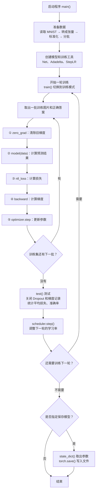
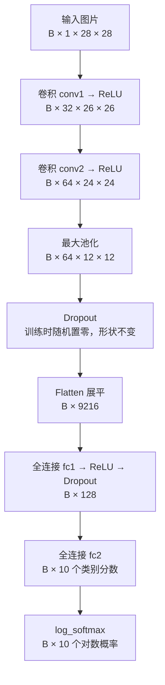

# MNIST 项目学习笔记：从输入图片到保存模型

本文配合 [MNIST 源码](../mnist/main.py) 复习，适合有数学基础和其他编程语言基础、刚开始接触 PyTorch 的学习者。

模型可以看成带参数的函数：输入图片，输出数字 0～9 对应的十个数。训练通过图片和正确答案调整参数；测试检查模型在未参与参数更新的图片上的表现。

## 1. 程序总体流程

“一批”（batch）是一次处理的一组图片；“一轮”（epoch）是完整遍历一次训练集。下面描述默认的完整训练流程，未使用 `--dry-run`。



### 先抓住三个连接

- **预测 → 损失**：用正确答案检查模型的预测。
- **损失 → 梯度 → 更新**：先计算参数变化对损失的影响，再更新参数。
- **训练 → 测试**：训练更新参数；测试使用当前参数做预测和统计。

`run_mnist.cmd` 默认使用 CPU，训练 1 轮并保存模型。直接运行 `main.py` 时，源码默认训练 14 轮，仅指定 `--save-model` 才保存。

## 2. 模型内部的数据流

`B` 表示一批图片的数量。训练默认 `B = 64`，测试默认 `B = 1000`，最后一批可以更小。



### 各步骤的作用

| 操作 | 简单理解 | 需要学习的参数 |
| --- | --- | --- |
| 卷积 `Conv2d` | 用可学习的小窗口扫描并组合局部特征 | 权重、偏置 |
| `ReLU` | 对每个数计算 `max(0, x)`，引入非线性 | 无 |
| 最大池化 | 每个 2 × 2 区域保留最大值，宽、高各减半 | 无 |
| `Dropout` | 训练时随机将部分元素置零，保留值按保留概率缩放 | 无 |
| `flatten(x, 1)` | 保留批次维，把每张图片的特征排成一个向量 | 无 |
| 全连接 `Linear` | 对全部输入做加权求和并加偏置 | 权重、偏置 |
| `log_softmax` | 将类别分数转换为对数概率 | 无 |

灰度图只有亮度这一个输入通道。卷积输出中的通道代表学习到的特征图。第二层卷积的每个输出通道都会综合全部 32 个输入通道的信息。

展平后的长度来自 `64 × 12 × 12 = 9216`。全连接层依次将特征数量从 `9216` 转为 `128`，再转为 `10`。

只有加权求和与偏置时，叠加的仿射变换仍能合并为一个仿射变换。ReLU 引入非线性，使网络能表达更丰富的规律。例如 `ReLU(x) + ReLU(-x) = |x|`，可以表示 V 形关系。

## 3. 训练的五行核心代码

```python
optimizer.zero_grad()
output = model(data)
loss = F.nll_loss(output, target)
loss.backward()
optimizer.step()
```

1. `zero_grad()`：清除上一批留下的梯度，已经学到的参数保留。
2. `model(data)`：调用模型的 `forward()`，输出形状为 `[B, 10]` 的对数概率。
3. `nll_loss()`：取每张图片正确类别的对数概率并取负，默认对这一批取平均。
4. `backward()`：沿计算过程使用链式法则求导，将各参数的梯度保存到 `.grad`。
5. `step()`：优化器读取梯度，根据更新规则修改参数。

`data` 是图片；`target` 是数据集提供的正确数字。模型只接收 `data`，`target` 用于计算损失。

对于一张图片，损失为 `-ln(正确类别的概率)`。概率越大，损失越小。例如概率为 `0.9` 时，损失约为 `0.105`；概率为 `0.1` 时，损失约为 `2.303`。

梯度描述参数变化对损失的影响。最简单的梯度下降使用“新参数 = 旧参数 - 学习率 × 梯度”；本项目采用 **Adadelta**，还会参考梯度及更新量的历史统计，计算各参数的更新尺度。

## 4. 测试时做什么

`test()` 使用 10,000 张测试图片，逐批计算预测，最终统计平均损失和准确率。

- `model.eval()`：切换到评估模式，在本模型中关闭 Dropout。
- `torch.no_grad()`：关闭求梯度所需的记录，节省计算和内存。
- `output.argmax(dim=1, keepdim=True)`：为每张图片找出最大值的类别下标，即预测数字。
- `pred.eq(target.view_as(pred)).sum().item()`：调整标签形状、逐个比较并统计正确数量。
- `reduction='sum'`：先累计每批所有样本的损失，最后除以测试图片总数。

准确率 = 识别正确的图片数 ÷ 测试图片总数 × 100%。测试不调用 `backward()` 和 `optimizer.step()`，不根据测试答案更新参数。下一轮 `train()` 会重新切换到训练模式。

## 5. 学习率如何变化

```python
scheduler = StepLR(optimizer, step_size=1, gamma=args.gamma)
```

每轮训练、测试结束后调用一次 `scheduler.step()`。默认初始学习率为 `1.0`，`gamma = 0.7`，所以各轮使用的学习率依次为：

| 轮次 | 训练时使用的学习率 |
| --- | --- |
| 1 | 1.0 |
| 2 | 0.7 |
| 3 | 0.49 |
| 4 | 0.343 |

`StepLR` 按预设步数调整学习率，不根据测试结果自动决定是否衰减。只训练一轮时，最后虽然调用了调度器，但没有下一轮使用调整后的学习率。

## 6. 保存模型

```python
if args.save_model:
    torch.save(model.state_dict(), "mnist_cnn.pt")
```

- `state_dict()`：返回按名称组织的模型状态。在本模型中，主要是卷积层和全连接层的权重、偏置。
- `torch.save()`：将这些状态写入文件，供以后读取。
- 使用启动脚本时，模型文件位于仓库的 `mnist/mnist_cnn.pt`。
- 加载时先创建相同结构的 `Net()`，再用 `load_state_dict()` 加载参数；识别图片前调用 `eval()`。
- 当前训练脚本每次创建新模型，从头训练；同名模型文件会被覆盖。此处没有保存优化器状态和训练轮次。

## 7. 按这个顺序复习源码

1. 文件底部的 `if __name__ == '__main__'`：找到程序入口。
2. `main()`：看数据准备、模型创建及每轮训练和测试的组织方式。
3. `Net.__init__()` 与 `Net.forward()`：看层的定义和数据形状变化。
4. `train()`：对照五行核心代码理解参数怎样学习。
5. `test()`：理解如何在不更新参数的情况下评价模型。
6. `scheduler.step()` 和保存代码：理解轮次之间、训练结束后的处理。

环境安装与运行命令见 [MNIST 入门说明](入门说明.md)。全部示例的中文索引见 [中文首页](../README.md)。
